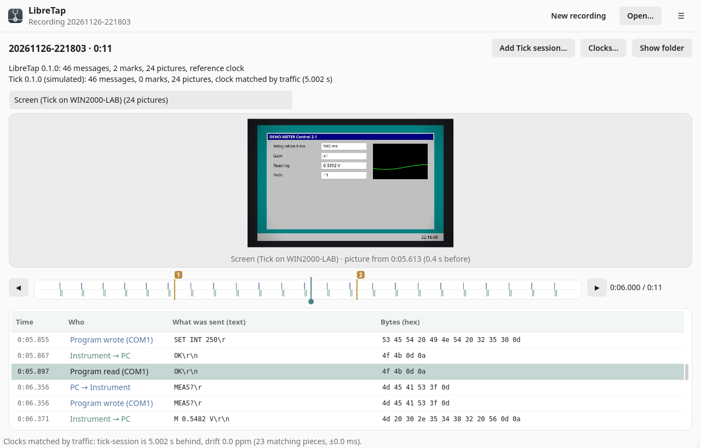
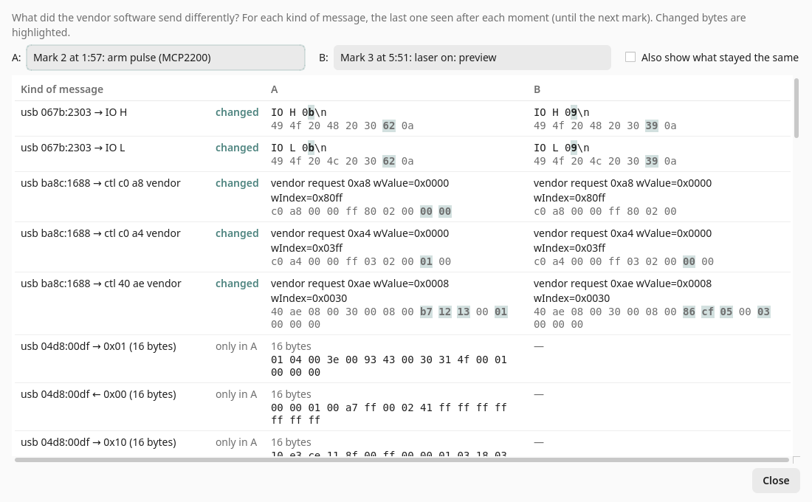

# LibreTap

**Your instrument outlived its computer.**

LibreTap liberates old lab instruments from the old PCs that run their vendor software. While an operator uses the
vendor program as usual, LibreTap listens on a laptop: passive sniffers record every byte between the PC and the
instrument, and a webcam keeps pictures of the PC's screen. Afterwards the timeline shows screen and traffic side
by side, so anyone (or an AI assistant) can work out what each setting sends, and write new software for the
instrument.





- **Serial tap**: a passive two-lead DB-9 tap and two USB-serial adapters (one per direction). The adapters only
  listen; nothing is ever sent.
- **USB sniffer**: a Raspberry Pi Pico spliced into the instrument's USB cable (low/full speed). With LibreTap's own
  firmware ([USB Sniffer Stream](firmware/pico-usb-sniffer/), a fork of usb-sniffer-lite) it records continuously
  like the other sources; with usb-sniffer-lite it captures in short pieces (Record, one action, Stop). Control requests are named
  (descriptors, CDC, FTDI/CH34x/PL2303/CP210x), data is shown per endpoint.
- **Ethernet**: a switch with port mirroring (e.g. TP-Link TL-SG105E) copies the instrument's and the PC's traffic to
  the laptop; Wireshark's dumpcap captures it, LibreTap shows the TCP/UDP conversations like serial traffic.
- **Camera**: a full-resolution still of the instrument PC's screen every half second (only when it changes).
  LibreTap finds the screen in the picture and says under the live view whether its text is readable (*Text
  readable*, *Too blurred*, *Too bright*, …). *Optimise picture* sets exposure and focus for the screen;
  *Picture…* has the camera's settings and the screen region (draw it if it is not found). The camera starts
  from its own defaults and gets its previous settings back when LibreTap closes it. Settings: Linux cameras
  only for now; the readability check works on every system.
- **Tick**: a small companion program for the old PC itself (Windows 2000 to 11, separate project) records the
  screen and the vendor program's port calls in the same format. *Add Tick session…* combines its folder with
  LibreTap's recording; the clocks are lined up automatically from the traffic both saw, or with the Sync button.
  Tick comes inside LibreTap's installers: *Copy Tick to a USB stick…* (or `LibreTapCLI tick copy FOLDER`) puts it
  on a stick for the old PC. It is also a separate download on the releases page (`Tick-…-Windows.zip`,
  `tick-…-linux-x86_64.tar.gz`), for those who only need Tick.
- **USBPcap import**: a Wireshark/USBPcap capture made on the instrument PC, only the chosen devices (keyboards
  and USB sticks stay out).
- **Before and after**: select a message and the screen is shown just before it and just after it, side by side,
  with what changed outlined: a setting changed on the screen before a command, a reading appears after an answer.
- **Marks**: press Mark (space bar) and say what you are about to change; marks appear on the timeline.
- **Agents**: everything works from the command line, also against the running window:
  `LibreTapCLI status | start | mark "note" | sync | stop | ports | sessions | show | match | import`, all with
  `--json`.
- **Analysis** (the second half): questions and answers with repeats folded, compare two moments byte by byte,
  clues per kind of message (framing, length fields, checksum and CRC candidates, values that follow the marks),
  key frames of the screen, an export for an assistant, and **protocol descriptions** (a small JSON file per
  instrument, [docs/PROTOCOL-FORMAT.md](docs/PROTOCOL-FORMAT.md)) that turn each message into a sentence and show
  how much is explained. All in the window (Analyze) and on the command line.
- **For AI assistants**: [AGENTS.md](AGENTS.md) — commands, workflow with the operator, safety rules.
- **Cora 5000 example**: `LibreTap --demo cora` opens a real (filtered) recording of an Anton Paar Cora 5000 Raman
  spectrometer's vendor software with its protocol description (95 % of the bytes explained).
- **Demo**: no hardware? `LibreTap --demo` (or Help ▸ Try the demo) records a pretend instrument.

**Status: version 0.1, untested on real hardware.** Tested with pseudo-terminals, a simulated Pico, synthetic
network captures and a stand-in dumpcap, simulated cameras, and real Tick sessions recorded under Wine; Windows and
macOS builds and the installers' permission steps are set up in CI but not yet run.

## Hardware

Printable build guides (PDF, A4) for scientists who have never soldered, with drawings for every step:

- [Serial tap: build guide](docs/hardware/serial-tap-build.pdf): the passive DB-9 tap (two USB–RS-232 adapters).
- [USB sniffer: build guide](docs/hardware/usb-sniffer-build.pdf): a Raspberry Pi Pico spliced into a USB extension.
- [Pico firmware: flashing](docs/hardware/pico-firmware-flashing.pdf): USB Sniffer Stream on Windows, macOS and Linux.

Sources: `docs/hardware/src/` (drawings and text in Python, written to HTML), built with
`docs/hardware/build-pdfs.sh` (Chrome or Chromium). Untested on real instruments.

## What the installers change on your system

Capturing network traffic needs permission, so the installers set it up (this changes system settings):

- **Linux (.deb)**: installs everything it uses with it: Wireshark (the program and its dumpcap), `ffmpeg`, and
  Qt's X11 and Wayland window plugins. During installation Wireshark asks *Should non-superusers be able to capture
  packets?* (a tick-box in graphical installers, Yes/No in a terminal). Either choice works: LibreTap's
  post-install script then allows capture anyway, for the user who installed it: a `wireshark` group, dumpcap
  runnable by that group with the network-capture capabilities (`cap_net_raw,cap_net_admin`), and that user (via
  sudo or pkexec) in the group. Until the next login, LibreTap starts dumpcap through `sg wireshark`. Undo:
  `sudo dpkg-reconfigure wireshark-common` (choose No) and `sudo gpasswd -d $USER wireshark`. If capture is not
  possible, Record offers *Set it up now* (asks for the administrator password).
- **Windows**: Npcap (the capture driver) may not be bundled under its licence. The installer offers, checked when
  Wireshark is missing, to download Wireshark's official installer from wireshark.org, which installs dumpcap and
  offers Npcap; you click through it (it asks for administrator rights). LibreTap itself installs per user.
- **macOS**: nothing is changed. For Ethernet capture install Wireshark including its "ChmodBPF" part (it gives your
  user access to the capture devices); the Connections area tells you when it is missing.

The serial tap and the USB sniffer need no special rights on Windows and macOS; on Linux your user must be in the
`dialout` group (most desktop distributions do this for the first user).

## Build

Qt 6.5+ (Core, Gui, Widgets, SerialPort, Network), CMake, a C++17 compiler; ffmpeg for cameras on Windows/macOS;
Wireshark's dumpcap for Ethernet capture (pcap/pcapng files are read by LibreTap itself).

```
cmake -S app -B build -G Ninja -DCMAKE_BUILD_TYPE=Release
cmake --build build
ctest --test-dir build
```

Recordings go to `~/LibreTap` (change under Advanced…, or `$LIBRETAP_HOME`). The file format is plain JSON lines and
pictures: see [docs/FORMAT.md](docs/FORMAT.md).

MIT licence (app/LICENSE).
