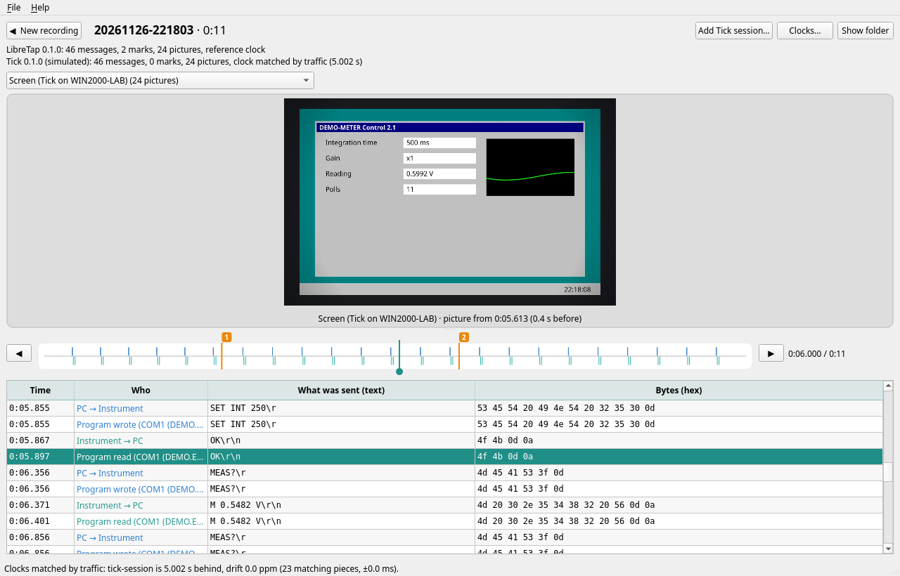

# LibreTap

**Your instrument outlived its computer.**

LibreTap liberates old lab instruments from the old PCs that run their vendor software. While an operator uses the
vendor program as usual, LibreTap listens on a laptop: passive sniffers record every byte between the PC and the
instrument, and a webcam keeps pictures of the PC's screen. Afterwards the timeline shows screen and traffic side
by side, so anyone (or an AI assistant) can work out what each setting sends, and write new software for the
instrument.



- **Serial tap**: a passive two-lead DB-9 tap and two USB-serial adapters (one per direction). The adapters only
  listen; nothing is ever sent.
- **Camera**: a full-resolution still of the instrument PC's screen every half second (only when it changes).
- **Tick**: a small companion program for the old PC itself (Windows 2000 to 11, separate project) records the
  screen and the vendor program's port calls in the same format. *Add Tick session…* combines its folder with
  LibreTap's recording; the clocks are lined up automatically from the traffic both saw, or with the Sync button.
- **Marks**: press Mark (space bar) and say what you are about to change; marks appear on the timeline.
- **Agents**: everything works from the command line, also against the running window:
  `LibreTapCLI status | start | mark "note" | sync | stop | ports | sessions | show | match | import`, all with
  `--json`.
- **Demo**: no hardware? `LibreTap --demo` (or Help ▸ Try the demo) records a pretend instrument.

USB (Raspberry Pi Pico sniffer) and Ethernet (port mirroring) are planned.

**Status: version 0.1, untested on real hardware.** Tested with pseudo-terminals, simulated cameras and simulated
Tick sessions only; Windows and macOS builds are set up in CI but not yet run.

## Build

Qt 6.5+ (Core, Gui, Widgets, SerialPort, Network), CMake, a C++17 compiler; ffmpeg for cameras on Windows/macOS.

```
cmake -S app -B build -G Ninja -DCMAKE_BUILD_TYPE=Release
cmake --build build
ctest --test-dir build
```

Recordings go to `~/LibreTap` (change under Advanced…, or `$LIBRETAP_HOME`). The file format is plain JSON lines and
pictures: see [docs/FORMAT.md](docs/FORMAT.md).

MIT licence (app/LICENSE).
