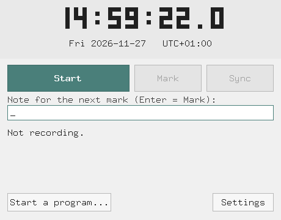
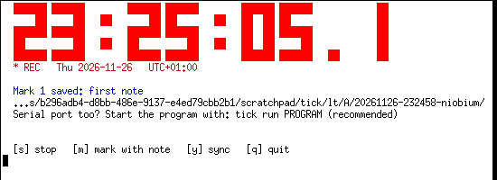

# Tick

Tick is LibreTap's little helper for the instrument's own computer. It runs **on the old PC** next to the vendor
software and records what happens there into a session folder that LibreTap opens on its timeline:

- **the screen**: a screenshot every 0.5 s, of which only the parts that changed are stored (PNG); nothing is
  stored while the screen stands still, so an hour usually takes a few MB;
- **what the vendor program does on its ports** (if you start the program from Tick): serial (COM) ports with their
  settings, network connections (TCP/UDP: who it talks to and every byte), and USB/HID/vendor-driver devices
  (transfers, reports, control requests, device I/O controls), with the time. There is nothing to choose: Tick
  records whatever the program uses and says in plain words what it found ("VENDOR.EXE opened COM1: 9600 baud, 8N1,
  hardware handshake (RTS/CTS)", "VENDOR.EXE connected to 192.168.0.20:5000 (TCP)", "VENDOR.EXE opened USB device
  VID 0403 PID 6001"). *Advanced* can leave a kind out;
- **marks** (with a note) and **sync** presses, and the title of the active window.


It is one small file, `Tick.exe` (about 115 kB), for Windows 2000, XP, Vista, 7, 8, 10 and 11 (32 and 64 bit, and
for 32- and 64-bit vendor programs); Windows 95/98/ME and NT 4 are best effort. Nothing to install. Read
[SAFETY.md](SAFETY.md) before using it next to an instrument.

**Which file?** Use `Tick.exe`. Use `TickEyes.exe` (about 50 kB, "eyes only") only if the PC's IT rules or
antivirus do not accept Tick: it is the same program without the listener inside (no "Start a program...", no DLL
at all), so it watches the screen and records marks and syncs, but does not listen to the ports.

## Use

1. Copy `Tick.exe` to a USB stick (or any folder) and double-click it on the instrument PC. Get it from the
   [releases page](https://github.com/ohlincha/libretap/releases) (`Tick-…-Windows.zip`), or from LibreTap on
   your laptop: *Copy Tick to a USB stick…*.
2. Press **Start**. The window shows the folder it records into: `TickSessions\` next to `Tick.exe` (if that
   folder cannot be written: `Documents\TickSessions`, then the TEMP folder).
3. **Recommended:** press **Start a program...** and choose the program that talks to the instrument: from the
   list (programs running now, Start menu and Desktop shortcuts, installed programs), with **Browse...** (a
   program or a shortcut), or with **Pick window** (click its window). A program or shortcut can also be dropped
   onto Tick's window. Tick starts it with the shortcut's arguments and *Start in* folder and records its ports
   from the start. If the program is already running, Tick asks, then closes it (as its own close button does)
   and starts it again. On Windows 2000 and later, *No* listens without restarting instead: port settings made
   earlier are missed; Tick reads the current ones once. If several copies of the program are running, Tick
   restarts none and asks you to close them first. Consoles and shells (cmd.exe, PowerShell) are never offered.
4. Work as usual. Press **Mark** (or type a note and press Enter) at moments that matter: "integration time
   changed to 1 s". Press **Sync** when the laptop's LibreTap does too, or film Tick's clock with LibreTap's camera.
5. Press **Stop**, close Tick, take the stick to the laptop and add the session folder in LibreTap.

The big clock is the PC's own clock (HH:MM:SS.tenths, local time); every recorded time uses exactly that clock,
so a camera photo of Tick's window ties the PC's time to the laptop's.

Settings (*Settings...* or `Tick.ini` next to `Tick.exe`, section `[tick]`): `interval_ms` (500), `full_every` (60),
`tile` (32), `cursor` (1), `window_titles` (1), `hide_tick_window` (1), `on_top` (1), `copy_settings` (1),
`program_windows_only` (0), `sessions_folder` (empty).

By default the whole screen is recorded. *Settings... > Screenshots show only the vendor program's windows* keeps
only the visible windows (including dialogs and pop-ups) of the program Tick started or listens to and paints the
rest black, e.g. when other things on the screen must not be recorded. When Tick is not listening to a program,
*Pick window* then asks you to click on the program's window. Windows of other programs that lie on top of the
vendor program's window are still visible inside its area.

For scripts: `Tick.exe /start` starts recording at once; `Tick.exe /run C:\path\VENDOR.EXE [arguments]` starts
recording and the program; `Tick.exe C:\path\Vendor.lnk` (or a program; also what Explorer passes when a file is
dropped onto Tick.exe's icon) does the same as choosing it in *Start a program...*.

The session format is described in [../docs/FORMAT.md](../docs/FORMAT.md).

## Linux

`build/linux/tick` (about 1 MB, one static x86-64 binary, no root, nothing to install) does the same on Linux
PCs (and lets LibreTap be tested end to end on a Linux desktop). Started from a file manager or desktop it opens
a window like Tick for Windows: Start/Stop, Mark (+ note), Sync, *Start a program...* (applications menu,
programs running now that use a serial port, USB device or network connection, Browse, Pick window) and
*Settings*. Started in a terminal it shows a terminal clock: `s` start/stop, `m` mark (+ note, Enter), `y` sync,
`p` start a program (list; `w` pick window), `o` settings, `q` quit. Settings are saved in `tick.ini` next to
`tick` if that folder is writable, else `~/.config/tick/tick.ini`. A running program is restarted only after
asking: Tick closes it (SIGTERM, as a desktop's close does; never killed) and starts the same command in the same
folder with the same environment. Linux cannot listen to a program without restarting it.

For scripts and agents:

```
tick run [options] -- PROGRAM [ARGS]   # record and start PROGRAM listening; PROGRAM may be a .desktop file or menu name
tick ctl status|start|stop|mark NOTE|sync|quit|programs|open NAME|yes|no   # control a running tick (JSON answers)
options: --gui  --dir DIR  --interval MS  --full-every N  --no-screen  --no-titles  --start  --no-tui  --until-exit  --control PATH
```

 

- Screen: spoken X11 protocol directly over the display's socket (GetImage of the root window; no libX11
  needed), so it works under Xorg, Xvfb and for X programs on XWayland. On a Wayland-only desktop it says that
  screen recording is not supported yet and records only the listener, marks and syncs. The terminal Tick runs in
  is painted grey in the pictures when the terminal sets `WINDOWID` (xterm, konsole, ...). The mouse pointer
  and the "vendor program's windows only" option are Windows-only for now. Active window titles come from the
  window manager (`_NET_ACTIVE_WINDOW`).
- Serial listener: `tick run` starts the program with `LD_PRELOAD=libtickhook.so` (carried inside `tick`, written
  to `<session>/tick/`, or `$XDG_RUNTIME_DIR`/`/tmp` if the session folder is on a `noexec` mount). The library
  defines `open`/`openat`/`read`/`write`/`readv`/`writev`/`ioctl`/`tcsetattr`/`tcflush`/`tcsendbreak`/`close`,
  `connect`/`accept`/`accept4`/`send`/`recv`/`sendto`/`recvfrom`/`sendmsg`/`recvmsg` (+ `_FORTIFY_SOURCE`
  variants), does the real work as raw system calls and records calls on terminal devices (serial ports, USB
  adapters, pseudo-terminals), TCP/UDP sockets (not Unix sockets such as X11 or D-Bus), and USB devices
  (`/dev/bus/usb/*` usbfs control/bulk/URB transfers as used by libusb, `/dev/hidraw*`, `/dev/usbtmc*`,
  `/dev/usb/*`) into the same lock-free ring as on Windows, in `/dev/shm`. Options `--no-serial`, `--no-net`,
  `--no-usb` leave a kind out.
  Programs the vendor program starts are listened to as well. It needs only `getenv` and `__errno_location` from
  libc (any glibc since 2.2.5, or musl). The status line says in words what was found ("PROGRAM opened
  /dev/ttyUSB0: 9600 baud, 8N1, no handshake"). The program runs in its own process group with its terminal
  output in `<session>/tick/program-output.log` (when the terminal UI is used).
- Limits: DNS lookups made inside libc and other libc-internal socket use are not seen (the program's own calls
  are); statically linked and setuid programs ignore `LD_PRELOAD` (they run normally, unrecorded); 32-bit
  programs cannot load the 64-bit library (same); serial I/O through stdio (`fopen`/`fprintf` on the port) or
  io_uring is not seen; no attaching to a running program. Runs on x86-64 Linux with kernel 3.2 or later; no
  32-bit (i686) build yet (needs a 32-bit libc to link against).
- Build: `make linux` (gcc, glibc static libs; `make linux-check` checks it is static and what the library
  imports). Tests: `tests/linux-test.sh SCRATCH` (Xvfb, xterm, xclock, xdotool, ImageMagick).

## macOS (plan, not built)

- Screen: `CGDisplayCreateImage` (10.6-14) or ScreenCaptureKit (12.3+); both need the *Screen Recording*
  permission, which the user grants once in System Settings (Tick must explain this on first start).
- Listener: `DYLD_INSERT_LIBRARIES=libtickhook.dylib` with interposing (`__DATA,__interpose`) for
  open/read/write/ioctl/tcsetattr/close, the same ring in shared memory. Works only for programs that are not
  hardened/notarised with library validation and not protected by SIP: fine for old vendor software, not for
  current App Store or notarised apps. The ring, session writer, PNG and diff code are shared as on Linux.
- CI: GitHub's macOS runners can build both and run the listener against a fake vendor program on a
  pseudo-terminal; screen capture cannot be tested there (no permission prompt can be answered headless), so it
  needs one manual test on a real Mac.

## How it works

- Plain C, Win32 API only, no C runtime: own entry point, `HeapAlloc`, own text and number formatting. i686,
  compiled for 486-class CPUs. PE OS/subsystem version 4.0. ANSI (`...A`) functions; anything newer than Windows
  95/2000 (`GetCursorInfo`, `SetProcessDPIAware`, `VirtualAllocEx`, `CreateRemoteThread`, Toolhelp, ...) is
  loaded with `GetProcAddress` and Tick works without it.
- Screen: `BitBlt` of the (virtual) screen into a 32-bit DIB on a low-priority thread; compared with the previous
  picture in 32x32 tiles; changed tiles are merged into rectangles; each rectangle is written as a PNG with Tick's
  own encoder (`src/png.c`: LZ77 with hash chains + fixed Huffman deflate, None/Sub/Up row filters, no third-party
  code).
- 64-bit vendor programs (64-bit Windows only): Tick (always 32-bit) unpacks `TickHook64.dll` and a 10 kB
  `TickHelper64.exe` into `<session>\tick\`; the helper points the suspended program's thread at an x86-64 stub
  (or starts a remote thread when attaching) and exits; the 64-bit DLL writes into the same ring. Bitness comes
  from the .exe's PE header (attach: `IsWow64Process`). On 32-bit Windows none of this is used.
- Serial listener: Tick starts the program suspended, points its first thread at a 60-byte stub that loads
  `TickHook.dll` (carried inside Tick.exe, written to `<session>\tick\`) and calls `TickInit`, then lets it run.
  The DLL patches the import tables of the program's modules (and hooks `GetProcAddress`/`LoadLibrary*` for late
  binding) for `CreateFileA/W`, `ReadFile`, `WriteFile`, `GetOverlappedResult`, `DeviceIoControl`,
  `SetCommState`, `SetCommTimeouts`, `EscapeCommFunction`, `SetCommBreak`, `ClearCommBreak`, `PurgeComm`,
  `SetupComm`, `TransmitCommChar`, `CloseHandle`; network: Winsock `connect`, `accept`, `send`, `recv`,
  `sendto`, `recvfrom`, `WSASend`, `WSARecv`, `WSASendTo`, `WSARecvFrom` (overlapped receives completed through
  `WSAGetOverlappedResult`/`GetOverlappedResult`), `closesocket` (wsock32.dll programs too: its functions forward to
  ws2_32 on NT); USB: device handles opened with `CreateFile` on `\\?\usb#…`, `\\?\hid#…` or `\\.\<driver>` paths
  (ReadFile/WriteFile/DeviceIoControl on them), `HidD_Get/SetFeature`, `HidD_GetInputReport`,
  `HidD_SetOutputReport`, `WinUsb_Initialize/ControlTransfer/ReadPipe/WritePipe/Free`. Each hook calls the real function first and keeps its result and
  error code; it then puts a record into a 1 MB lock-free ring in shared memory (`src/ring.c`) and never waits:
  if the ring is full the record is dropped and counted. Tick reads the ring every 25 ms. When Tick stops or
  closes, the hooks pass calls straight through. Network, USB and file hooks are meant to be added as more lines
  in the DLL's hook table.
- Events are appended to `events.jsonl` line by line and flushed at least once a second (marks, syncs and errors
  at once).

## Build

Needs a mingw-w64 cross compiler for i686, e.g. [llvm-mingw](https://github.com/mstorsjo/llvm-mingw) unpacked
anywhere (the Makefile finds `~/opt/llvm-mingw-*`; or `make CROSS=/path/to/bin/i686-w64-mingw32-`), plus gcc
and python3 for the native tests.

```
make              # build/Tick.exe (TickHook.dll, TickHook64.dll, TickHelper64.exe inside) and build/TickEyes.exe
make check        # import allow-list check (tools/check-imports.sh) + native unit tests
make linux        # build/linux/tick (static) with libtickhook.so inside
make tools-test   # test helpers for Wine runs: tickctl.exe, fakevendor.exe, fakewinvendor.exe, mklink.exe, ...
WINE=/path/to/wine tests/wine-test.sh win2k /tmp/tickwine     # end-to-end under Wine + Xvfb
WINE=/path/to/wine tests/wine-safety.sh win2k /tmp/tickwine   # worst cases (kill Tick, kill program, ...)
WINE=/path/to/wine tests/wine-test64.sh win7 /tmp/tickwine    # 64-bit program, TickEyes, program-only capture
WINE=/path/to/wine tests/wine-test-netusb.sh win7 /tmp/tickwine  # network + device listener, 32 and 64 bit
WINE=/path/to/wine tests/wine-test-programs.sh win7 /tmp/tickwine  # Start a program: list, shortcut, restart, Pick window
tests/linux-test-programs.sh /tmp/ticklinux                     # the same for Linux (window and terminal)
make test-usb     # USB decoding without hardware (native)
```

Needs the x86_64 compiler of the same toolchain for the 64-bit parts. `tools/check-imports.sh` fails if Tick.exe,
TickEyes.exe or TickHook.dll imports a function that is not in
`tools/win95-imports.txt` (functions present in both Windows 95 and 2000) or if the PE version is above 4.0.

## Tested and untested

Tested (2026-11-27), choosing the program (Tick 0.5): shortcut reading on hand-made Windows 95, XP..11, network
and %ProgramFiles% shortcuts, every truncation and every flipped byte (`make test`, address sanitizer), and on
shortcuts written by Wine's own IShellLink; under Wine (Windows XP and 7 mode, Xvfb) with a windowed test program on
COM1: the list (Start menu shortcut, installed-software entry merged with it, uninstaller left out), start from
the shortcut (its arguments and Start-in folder arrived), restart of the running program (closed with WM_CLOSE,
started again from its shortcut), Pick window by clicking + listening without restarting, a shortcut given on the
command line. Linux natively under Xvfb: `tick run` with a menu name (Exec and Path), the window (list by
keyboard, restart after the Yes button, Pick window on an xterm), the terminal's `p` and `o` screens and
`tick.ini`; `.desktop` parsing (`make test`). Dropping onto the window: Windows under Wine (a Start menu shortcut
dropped from an X11 drag source, which Wine delivers as WM_DROPFILES: started and listening), Linux (XDND v5: a
menu entry in a folder with spaces started; a text file refused; `file://` decoding in `make test`).
**Not tested**: a drop from a real file manager (Explorer, Nautilus, Dolphin, Thunar), Browse (the file
dialogs), the Windows list on Windows 95/98 or with real installed software, a Linux desktop with a window
manager (Xvfb has none, so the window-manager program list was empty).

Test isolation: tests that can close or restart programs never see the user's own programs. Linux tests set
`TICK_TEST_ROOT_PID` (Tick then lists, matches and closes only processes started under the test script; test L
checks that a copy outside is left alone) and run their windows in their own Xvfb; the inner scripts refuse to run
otherwise. Wine tests run in their own Wine prefix, whose wineserver holds only the test's programs.

Tested (2026-11-26), network and USB (Tick 0.4): under Wine (Windows 7 mode) 32- and 64-bit test programs talking
TCP and UDP to a fake network instrument on 127.0.0.1 (connect, send, recv, WSASend, overlapped WSARecv, sendto,
recvfrom, closesocket all recorded), and using a device handle (`\\.\NUL`: WriteFile, DeviceIoControl, HidD_SetFeature,
HidD_GetFeature recorded); natively on Linux the same network test (connect, send, recv, write, read, sendmsg,
recvmsg, sendto, recv); USB decoding without hardware (`make test-usb`: usbfs control/bulk/URB records and
Windows WinUSB/HID records through the converter). **Not tested**: any real USB device (WinUSB under Wine has no
`WinUsb_Initialize`; usbfs needs a device), IPv6, overlapped I/O with completion routines or I/O completion ports
(not recorded), 9x Winsock (wsock32 without ws2_32).

Tested (2026-11-26): Tick for Linux natively under Xvfb (terminal UI in xterm with xclock running, `tick run`
with a fake vendor program on a pseudo-terminal, control socket, kill -9 of tick / of the program, session folder
removed, quit while the program runs; `tests/linux-test.sh`); native unit tests (deflate/PNG round trip through Python's zlib, screen diff, ring buffer with
4 writer threads, JSON/UTF-8 text); Tick.exe under Wine 11.20 (WoW64) set to Windows 2000, XP and 7, in Xvfb:
screen recording, Mark/Enter/Sync, Stop/Start, `/run` with a test program talking to a fake instrument on a
pseudo-terminal mapped to COM1 (open, settings, timeouts, DTR, purge, writes, reads, overlapped reads, late-bound
`WriteFile`, close, exit code), and the worst cases listed in SAFETY.md. Tick 0.2 (Windows 7 mode): a 64-bit test
program listened to through TickHelper64/TickHook64; TickEyes.exe; program-windows-only capture with a 64-bit
notepad (Tick's own window, deliberately not masked, came out black).

**Not tested on real Windows or real hardware yet**: no run on an actual Windows 2000/XP/7/10/11 PC, none on
Windows 95/98 (the 9x injection path is written but has never run), not with a real vendor program, not on a
Pentium II. Wine's serial driver and window manager differ from Windows (e.g. DTR changes fail on a pty; no
always-on-top without a window manager). Not tested at all: *Pick the program's window...* and *Listen to a
running program* (32- and 64-bit). Known gaps: 16-bit (Windows 3.x) and DOS vendor programs cannot be
listened to (screen recording still works); `ReadFileEx`
completion routines are not seen; programs that talk to the port through a kernel driver of their own are not seen.
