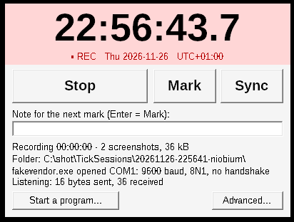

# Tick

Tick is LibreTap's little helper for the instrument's own computer. It runs **on the old PC** next to the vendor
software and records what happens there into a session folder that LibreTap opens on its timeline:

- **the screen**: a screenshot every 0.5 s, of which only the parts that changed are stored (PNG); nothing is
  stored while the screen stands still, so an hour usually takes a few MB;
- **what the vendor program does on its ports** (if you start the program from Tick): today its serial (COM) ports:
  port settings, every byte written and read, with the time. There is nothing to choose: Tick records whatever the
  program uses and says in plain words what it found ("VENDOR.EXE opened COM1: 9600 baud, 8N1, hardware handshake
  (RTS/CTS)"). USB and network calls will be recorded the same way when they are added;
- **marks** (with a note) and **sync** presses, and the title of the active window.



It is one small file, `Tick.exe` (about 115 kB), for Windows 2000, XP, Vista, 7, 8, 10 and 11 (32 and 64 bit, and
for 32- and 64-bit vendor programs); Windows 95/98/ME and NT 4 are best effort. Nothing to install. Read
[SAFETY.md](SAFETY.md) before using it next to an instrument.

**Which file?** Use `Tick.exe`. Use `TickScreen.exe` (about 50 kB) only if the PC's IT rules or antivirus do not
accept Tick: it is the same program without the listener inside (no "Start a program...", no DLL at all), so it
records the screen, marks and syncs only.

## Use

1. Copy `Tick.exe` to a USB stick (or any folder) and double-click it on the instrument PC.
2. Press **Start**. The window shows the folder it records into: `TickSessions\` next to `Tick.exe` (if that
   folder cannot be written: `Documents\TickSessions`, then the TEMP folder).
3. **Recommended:** press **Start a program...** and pick the vendor program's `.exe` instead of starting it from
   its usual icon. Tick starts it and records the port being opened and all its settings from the very start, and
   nothing of Tick is ever inside a program that was already running. (Advanced... > *Listen to a running program*
   is only for a program that is in the middle of a measurement and cannot be restarted: settings made before
   attaching are missed; Tick reads the current ones back once with `GetCommState`. Windows 2000 and later.)
4. Work as usual. Press **Mark** (or type a note and press Enter) at moments that matter: "integration time
   changed to 1 s". Press **Sync** when the laptop's LibreTap does too, or film Tick's clock with LibreTap's camera.
5. Press **Stop**, close Tick, take the stick to the laptop and add the session folder in LibreTap.

The big clock is the PC's own clock (HH:MM:SS.tenths, local time); every recorded time uses exactly that clock,
so a camera photo of Tick's window ties the PC's time to the laptop's.

Options (Advanced... or `Tick.ini` next to `Tick.exe`, section `[tick]`): `interval_ms` (500), `full_every` (60),
`tile` (32), `cursor` (1), `window_titles` (1), `hide_tick_window` (1), `on_top` (1), `copy_settings` (1),
`program_windows_only` (0), `sessions_folder` (empty).

By default the whole screen is recorded. *Advanced... > Screenshots show only the vendor program's windows* keeps
only the visible windows (including dialogs and pop-ups) of the program Tick started or listens to and paints the
rest black, e.g. when other things on the screen must not be recorded. When Tick is not listening to a program,
*Pick the program's window...* then asks you to click on the program's window. Windows of other programs that lie
on top of the vendor program's window are still visible inside its area. Command line: `Tick.exe /start` starts recording at once; `Tick.exe /run
C:\path\VENDOR.EXE [arguments]` starts recording and the program (handy in a shortcut).

The session format is described in [../docs/FORMAT.md](../docs/FORMAT.md).

## How it works

- Plain C, Win32 API only, no C runtime: own entry point, `HeapAlloc`, own text and number formatting. i686,
  compiled for 486-class CPUs. PE OS/subsystem version 4.0. ANSI (`...A`) functions; anything newer than Windows
  95/2000 (`GetCursorInfo`, `SetProcessDPIAware`, `VirtualAllocEx`, `CreateRemoteThread`, Toolhelp, ...) is
  loaded with `GetProcAddress` and Tick works without it.
- Screen: `BitBlt` of the (virtual) screen into a 32-bit DIB on a low-priority thread; compared with the previous
  picture in 32x32 tiles; changed tiles are merged into rectangles; each rectangle is written as a PNG with Tick's
  own encoder (`src/png.c`: LZ77 with hash chains + fixed Huffman deflate, None/Sub/Up row filters, no third-party
  code).
- 64-bit vendor programs (64-bit Windows only): Tick (always 32-bit) unpacks `TickHook64.dll` and a 10 kB
  `TickHelper64.exe` into `<session>\tick\`; the helper points the suspended program's thread at an x86-64 stub
  (or starts a remote thread when attaching) and exits; the 64-bit DLL writes into the same ring. Bitness comes
  from the .exe's PE header (attach: `IsWow64Process`). On 32-bit Windows none of this is used.
- Serial listener: Tick starts the program suspended, points its first thread at a 60-byte stub that loads
  `TickHook.dll` (carried inside Tick.exe, written to `<session>\tick\`) and calls `TickInit`, then lets it run.
  The DLL patches the import tables of the program's modules (and hooks `GetProcAddress`/`LoadLibrary*` for late
  binding) for `CreateFileA/W`, `ReadFile`, `WriteFile`, `GetOverlappedResult`, `DeviceIoControl`,
  `SetCommState`, `SetCommTimeouts`, `EscapeCommFunction`, `SetCommBreak`, `ClearCommBreak`, `PurgeComm`,
  `SetupComm`, `TransmitCommChar`, `CloseHandle`. Each hook calls the real function first and keeps its result and
  error code; it then puts a record into a 1 MB lock-free ring in shared memory (`src/ring.c`) and never waits:
  if the ring is full the record is dropped and counted. Tick reads the ring every 25 ms. When Tick stops or
  closes, the hooks pass calls straight through. Network, USB and file hooks are meant to be added as more lines
  in the DLL's hook table.
- Events are appended to `events.jsonl` line by line and flushed at least once a second (marks, syncs and errors
  at once).

## Build

Needs a mingw-w64 cross compiler for i686, e.g. [llvm-mingw](https://github.com/mstorsjo/llvm-mingw) unpacked
anywhere (the Makefile finds `~/opt/llvm-mingw-*`; or `make CROSS=/path/to/bin/i686-w64-mingw32-`), plus gcc
and python3 for the native tests.

```
make              # build/Tick.exe (TickHook.dll, TickHook64.dll, TickHelper64.exe inside) and build/TickScreen.exe
make check        # import allow-list check (tools/check-imports.sh) + native unit tests
make tools-test   # test helpers for Wine runs: tickctl.exe, fakevendor.exe, fakevendor64.exe
WINE=/path/to/wine tests/wine-test.sh win2k /tmp/tickwine     # end-to-end under Wine + Xvfb
WINE=/path/to/wine tests/wine-safety.sh win2k /tmp/tickwine   # worst cases (kill Tick, kill program, ...)
WINE=/path/to/wine tests/wine-test64.sh win7 /tmp/tickwine    # 64-bit program, TickScreen, program-only capture
```

Needs the x86_64 compiler of the same toolchain for the 64-bit parts. `tools/check-imports.sh` fails if Tick.exe,
TickScreen.exe or TickHook.dll imports a function that is not in
`tools/win95-imports.txt` (functions present in both Windows 95 and 2000) or if the PE version is above 4.0.

## Tested and untested

Tested (2026-11-26): native unit tests (deflate/PNG round trip through Python's zlib, screen diff, ring buffer with
4 writer threads, JSON/UTF-8 text); Tick.exe under Wine 11.20 (WoW64) set to Windows 2000, XP and 7, in Xvfb:
screen recording, Mark/Enter/Sync, Stop/Start, `/run` with a test program talking to a fake instrument on a
pseudo-terminal mapped to COM1 (open, settings, timeouts, DTR, purge, writes, reads, overlapped reads, late-bound
`WriteFile`, close, exit code), and the worst cases listed in SAFETY.md. Tick 0.2 (Windows 7 mode): a 64-bit test
program listened to through TickHelper64/TickHook64; TickScreen.exe; program-windows-only capture with a 64-bit
notepad (Tick's own window, deliberately not masked, came out black).

**Not tested on real Windows or real hardware yet**: no run on an actual Windows 2000/XP/7/10/11 PC, none on
Windows 95/98 (the 9x injection path is written but has never run), not with a real vendor program, not on a
Pentium II. Wine's serial driver and window manager differ from Windows (e.g. DTR changes fail on a pty; no
always-on-top without a window manager). Not tested at all: *Pick the program's window...* and *Listen to a
running program* (32- and 64-bit). Known gaps: 16-bit (Windows 3.x) and DOS vendor programs cannot be
listened to (screen recording still works); `ReadFileEx`
completion routines are not seen; programs that talk to the port through a kernel driver of their own are not seen.
